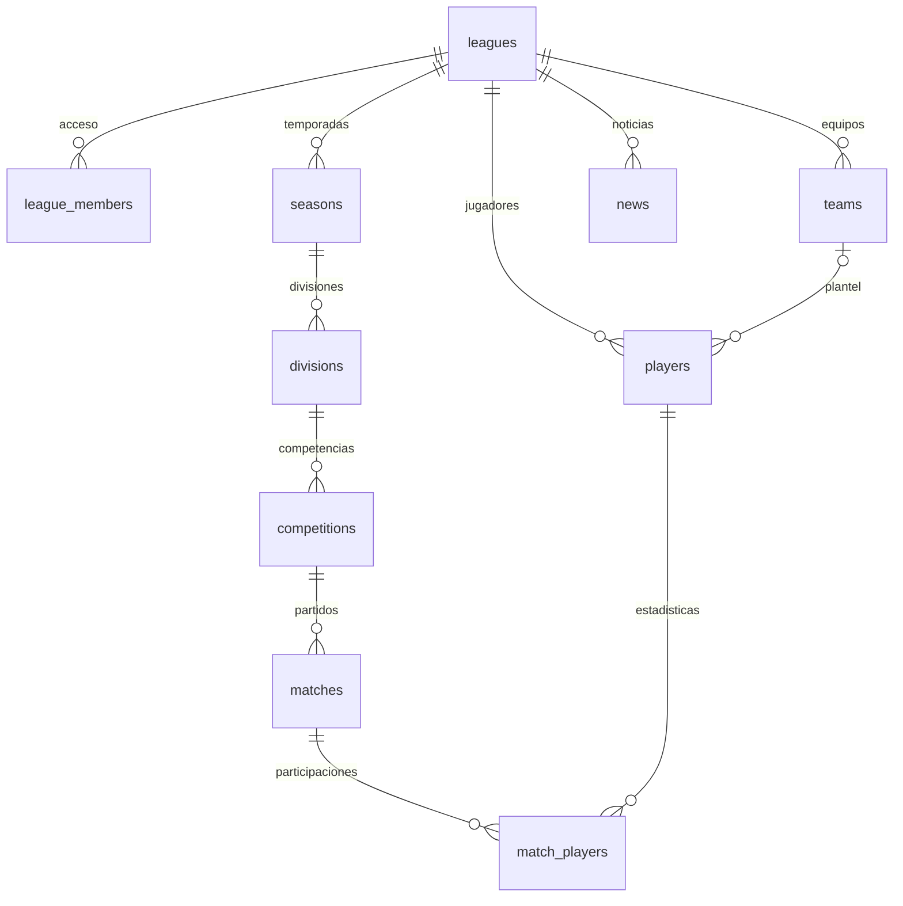

# Modelo de datos inicial

Fuente ejecutable: `supabase/schema/platform-v1.sql`. Aplicado al proyecto nuevo el 18/11/2026. Es un bootstrap para una base vacía; no ejecutarlo de nuevo como si fuera una migración incremental ni aplicar las migraciones históricas de APA a este proyecto.

| Entidad | Responsabilidad |
| --- | --- |
| `leagues` | Identidad, modalidad, formato inicial y puntajes configurables |
| `league_members` | Relación de Auth user con liga, rol owner/admin; privada |
| `seasons` | Temporada; bootstrap crea Temporada 1 |
| `divisions` | División dentro de temporada; bootstrap crea división inicial |
| `competitions` | Competencia de temporada/división; los partidos pertenecen a ella |
| `teams` | Equipo fijo, escudo y abreviatura |
| `players` | Persona deportiva, foto, posición y equipo opcional; no tiene login |
| `matches` | Programación, equipos o nombres variables, marcador y estado |
| `match_players` | Participación y estadísticas de una persona en un partido/lado |
| `news` | Título, contenido, imagen y estado de publicación |
| `private.league_creation_requests` | Idempotencia por usuario y petición de creación; sin acceso cliente |

Las tablas deportivas llevan `league_id`. Las claves compuestas impiden asociar, por ejemplo, un jugador de una liga con un partido de otra. `match_players.side` conserva el lado histórico: un cambio posterior de plantel no cambia los puntos ganados en partidos anteriores.

Las tablas de posiciones y los promedios se calculan desde resultados completados y participaciones. No mantener contadores manuales que puedan duplicarse al editar. Desempate inicial de equipos: puntos, diferencia de gol, goles a favor y nombre; falta decidir si el producto necesita enfrentamiento directo u otros criterios.

Auth es gestionado por Supabase; no se guardan contraseñas en tablas públicas. Solo cada usuario puede leer sus membresías. Los datos deportivos son públicos según las políticas. Las funciones de creación, resultados, fixture, partidos variables y administradores validan permisos en servidor. Las claves publicables no sustituyen a RLS.

Temporadas y divisiones están modeladas, pero la interfaz de múltiples temporadas/divisiones no está terminada. La primera versión trabaja con la estructura inicial generada al crear la liga.
